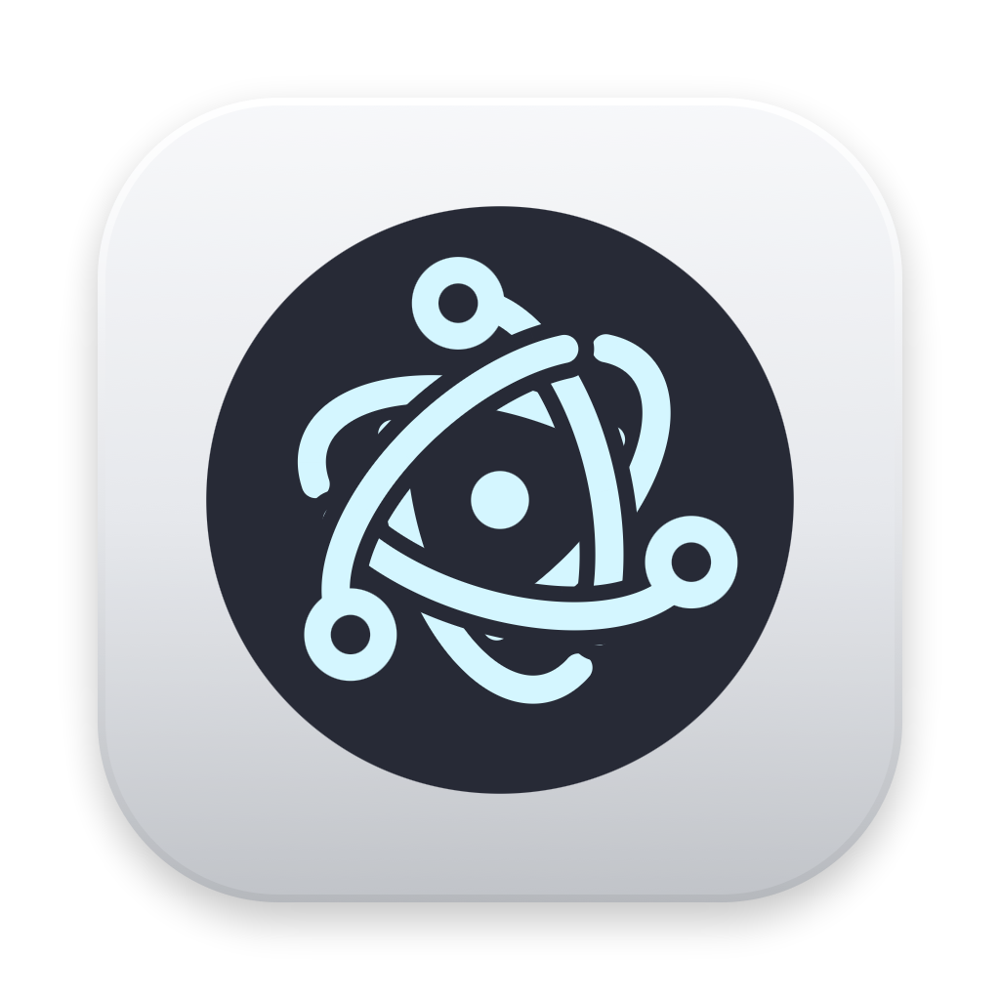
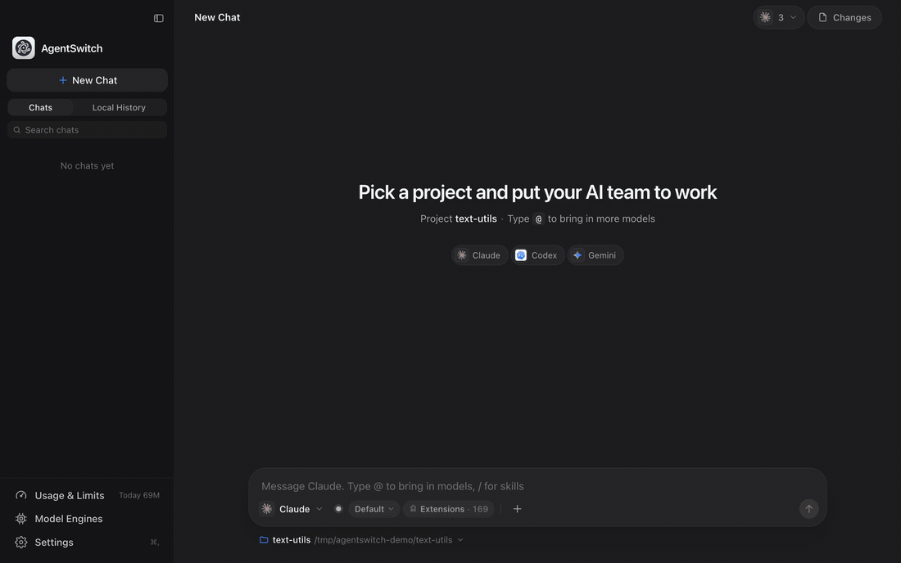

<p align="center">
  
</p>

<h1 align="center">AgentSwitch</h1>

<p align="center">
  One desktop workspace for the AI coding agents you already use: Claude Code, Codex CLI and Gemini (Antigravity CLI), side by side in the same chat.
</p>

<p align="center">
  <a href="LICENSE"></a>
  
</p>

<p align="center"><a href="https://agentswitch.app">Website</a> · English · <a href="README.zh-CN.md">简体中文</a></p>

<p align="center"></p>

## Why

You probably pay for more than one AI coding subscription, and each one lives in its own terminal. AgentSwitch runs the official CLIs for you and lets them work together:

- **Multi-agent chat.** Talk to one agent, then `@` another to review, continue or take over. Agents can hand work to each other, and failed steps can be sent back for a retry.
- **Your own subscriptions.** AgentSwitch drives the official CLIs you already have installed and signed in to. It never sees or stores your passwords, and it does not resell any API.
- **Local history in one place.** Browse, search and continue the sessions each CLI has already left on your Mac, then pick them up in a chat.
- **Usage at a glance.** Context-window fill for the current model, plus 5-hour and 7-day quota windows where the CLI reports them, with a warning when you near your limit.
- **Separate accounts.** Keep a work and a personal account for the same CLI, each with its own isolated sign-in.
- **Extensions.** Manage the MCP servers, skills and rules each CLI loads.
- **Built-in terminal** for installing, signing in to and debugging each CLI.

## Supported agents

| Agent | CLI | Install |
|---|---|---|
| Claude | Claude Code (`claude`) | `curl -fsSL https://claude.ai/install.sh \| bash` |
| Codex | Codex CLI (`codex`) | `npm install -g @openai/codex` |
| Gemini | Antigravity CLI (`agy`) | `curl -fsSL https://antigravity.google/cli/install.sh \| bash` |

You can also install and sign in from inside the app. More agents and local models are on the roadmap.

## Install

Download the latest `.dmg` from the [Releases](../../releases) page.

The app is ad-hoc signed, not notarized by Apple, so macOS blocks it the first time you open it. To get past this, right-click the app and choose **Open**, or run:

```bash
xattr -cr /Applications/AgentSwitch.app
```

### Build from source

**Requirements:** macOS (Apple Silicon), Node.js 22 LTS or newer, [pnpm](https://pnpm.io).

```bash
pnpm install   # also rebuilds node-pty for Electron
pnpm dev       # run in development mode
pnpm dist      # build the .dmg into dist/
```

## Privacy

- **Local only.** Chats, settings and usage statistics stay on your Mac, under `~/Library/Application Support/agentswitch`.
- **No telemetry.** AgentSwitch makes only two kinds of network requests itself:
  - the install script you choose to run;
  - Anthropic's usage endpoint, called with your own Claude sign-in, to show quota.

  Everything else goes through the official CLIs.
- **Never changes CLI files.** Your sessions under `~/.claude`, `~/.codex` and `~/.gemini` are only read. They are touched only when you explicitly choose to delete a session, and even then they are moved to the Trash.

## Development

```bash
pnpm typecheck
pnpm build
```

The main process is in `src/main`, the preload bridge in `src/preload`, the React UI in `src/renderer`, and shared types and translations in `src/shared`. UI strings live in four dictionaries (`src/shared/i18n/{zh-CN,zh-TW,en,ja}.ts`), and every new string needs all four.

## Contributing

Issues and pull requests are welcome. See [CONTRIBUTING.md](CONTRIBUTING.md). Pull requests require signing the [CLA](CLA.md) once, which a bot handles in the PR.

## Disclaimer

AgentSwitch is an independent project. It is not affiliated with, endorsed by or sponsored by Anthropic, OpenAI or Google. Claude, Codex, Gemini and their logos are trademarks of their respective owners. You are responsible for using each CLI in line with its provider's terms of service.

## License

[GNU Affero General Public License v3.0](LICENSE) (AGPL-3.0-only).

Copyright © 2026 xiaozhenyang
