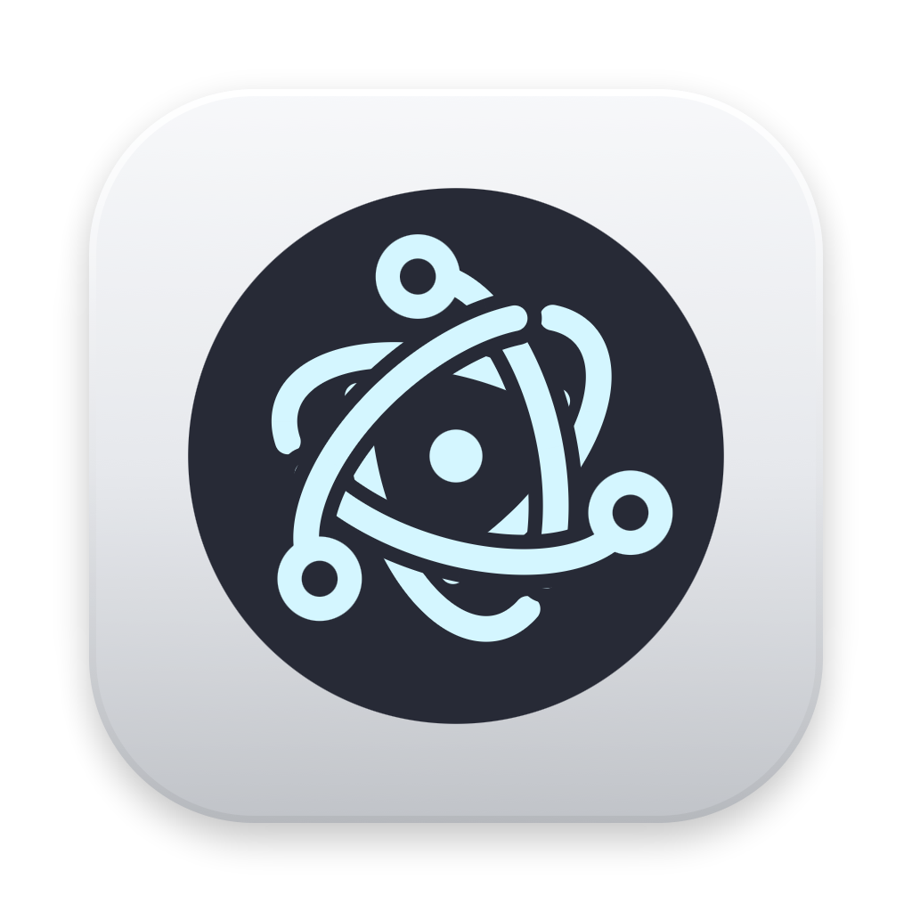
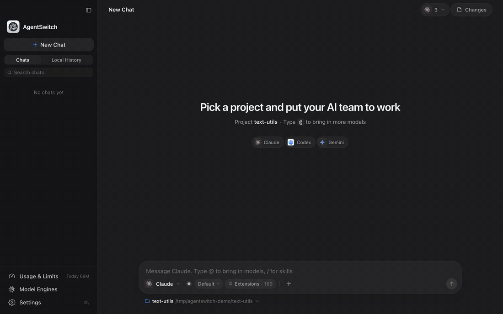

<p align="center">
  
</p>

<h1 align="center">AgentSwitch</h1>

<p align="center">
  把你已经在用的 AI 编程助手（Claude Code、Codex CLI、Gemini / Antigravity CLI）放进同一个对话里协作的桌面应用。
</p>

<p align="center">
  <a href="LICENSE"></a>
  
</p>

<p align="center"><a href="README.md">English</a> · 简体中文</p>

<p align="center"></p>

## 为什么做它

你大概同时订阅了好几家 AI 编程工具，但它们各自待在各自的终端里。AgentSwitch 替你驱动这些官方 CLI，让它们一起干活：

- **多模型同一个对话**：先和一个模型聊，再 `@` 另一个来审查、接着做或者接手。模型之间可以互相派活，失败的步骤可以打回重做。
- **用你自己的订阅**：直接驱动你本机已经安装并登录好的官方 CLI。AgentSwitch 不接触、不保存你的账号密码，也不转售任何 API。
- **本机历史集中管理**：各个 CLI 在本机留下的会话都能在这里浏览、搜索，并接着在对话里继续。
- **用量一目了然**：显示当前模型的上下文占用；CLI 提供额度数据时，还会显示 5 小时和 7 天额度，快用完时会提醒。
- **账号隔离**：同一个 CLI 可以加多个账号，比如工作号和私人号，各自独立登录、互不干扰。
- **扩展管理**：集中管理各个 CLI 加载的 MCP 服务器、技能（skills）和规则。
- **内置终端**：用来安装、登录和调试各个 CLI。

## 支持的 AI 助手

| 助手 | 命令行工具 | 安装命令 |
|---|---|---|
| Claude | Claude Code（`claude`） | `curl -fsSL https://claude.ai/install.sh \| bash` |
| Codex | Codex CLI（`codex`） | `npm install -g @openai/codex` |
| Gemini | Antigravity CLI（`agy`） | `curl -fsSL https://antigravity.google/cli/install.sh \| bash` |

也可以直接在应用里一键安装和登录。之后会支持更多助手和本地模型。

## 安装

从 [Releases](../../releases) 页面下载最新的 `.dmg`。

应用只做了本地签名（ad-hoc），没有经过 Apple 公证，所以第一次打开会被 macOS 拦截。解决方法：右键点击应用选「打开」，或者运行：

```bash
xattr -cr /Applications/AgentSwitch.app
```

### 从源码构建

**环境要求**：macOS（Apple Silicon）、Node.js 22 LTS 或更新版本、[pnpm](https://pnpm.io)。

```bash
pnpm install   # 会顺便为 Electron 重新编译 node-pty
pnpm dev       # 开发模式运行
pnpm dist      # 在 dist/ 下生成 .dmg
```

## 隐私

- **只存在本机**：对话、设置和用量统计都保存在你的 Mac 上，位置是 `~/Library/Application Support/agentswitch`。
- **没有遥测**：AgentSwitch 自己只发两类网络请求：
  - 你主动点击执行的 CLI 安装脚本；
  - 用你自己的 Claude 登录信息查询额度时，请求 Anthropic 的用量接口。

  其余请求都由官方 CLI 自己发出。
- **不改 CLI 的文件**：`~/.claude`、`~/.codex`、`~/.gemini` 里的会话只读不写。只有你明确选择删除某个会话时才会动它，而且是移到废纸篓。

## 开发

```bash
pnpm typecheck
pnpm build
```

代码结构：
- `src/main`：主进程
- `src/preload`：preload 桥接层
- `src/renderer`：React 界面
- `src/shared`：共享类型和多语言文案

界面文案有 4 套语言（`src/shared/i18n/{zh-CN,zh-TW,en,ja}.ts`），新增文案要 4 套都加上。

## 参与贡献

欢迎提 issue 和 PR，详见 [CONTRIBUTING.md](CONTRIBUTING.md)。提交 PR 前需要签一次 [贡献者协议（CLA）](CLA.md)，在 PR 里由机器人引导完成。

## 声明

AgentSwitch 是独立项目，与 Anthropic、OpenAI、Google 没有任何关联，也未获得它们的认可或赞助。Claude、Codex、Gemini 及其标志是各自所有者的商标。请按各家的服务条款使用对应的 CLI。

## 许可证

[GNU Affero General Public License v3.0](LICENSE)（AGPL-3.0-only）。

Copyright © 2026 xiaozhenyang
